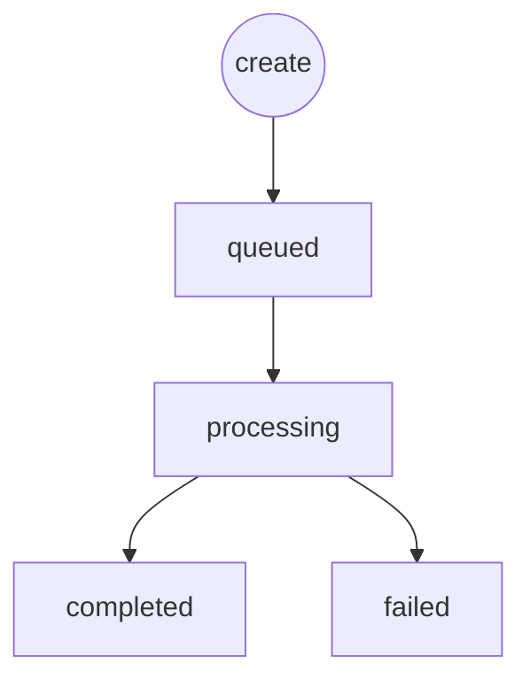

> Video URLs (`result.video_url`) are kept for about **3 days**. Download promptly.

Create and query share the same `data` shape. `data.cost` is the charged amount (credits).

For **Kling 4.0** (and similar per-second models with reference videos), query also returns `data.billing_duration` (seconds; upstream values preferred when present):

| Field | Description |
| :--- | :--- |
| `billing_duration.billable_seconds` | Actual charged video duration |
| `billing_duration.output_seconds` | Output / generated video duration (request `duration` until settled) |
| `billing_duration.reference_video_seconds` | Total reference video duration |

### Status values

| status | Meaning | progress |
| :--- | :--- | :--- |
| `queued` / `pending` / `submitted` | Submitted, waiting | `0` |
| `processing` / `in_progress` / `running` | Generating | `1–99` |
| `completed` / `success` / `succeeded` | Done — read `result.video_url` | `100` |
| `failed` | Failed — see `error_message` | `0` |



```bash
curl -X GET 'https://sigrunai.com/v1/videos/vid_xxxxxxxx' \
  -H 'Authorization: Bearer sk_xxx'
```

### Response example (Kling 4.0 completed)

```json
{
  "code": 20000,
  "msg": "ok",
  "data": {
    "task_id": "video_a1b2c3d4e5f6",
    "status": "completed",
    "progress": 100,
    "model": "kling-4.0-720p",
    "cost": 18,
    "billing_duration": {
      "billable_seconds": 18,
      "output_seconds": 8,
      "reference_video_seconds": 10
    },
    "created_at": 1729600000,
    "completed_at": 1729600120,
    "result": {
      "video_url": "https://sigrunai.com/oss/video/openapi/xxx.mp4"
    },
    "error_message": ""
  }
}
```

In this example, `billable_seconds` (18) is the charged duration; `output_seconds` is the generated clip length; `reference_video_seconds` is the reference video total; `cost` is credits after settlement.
