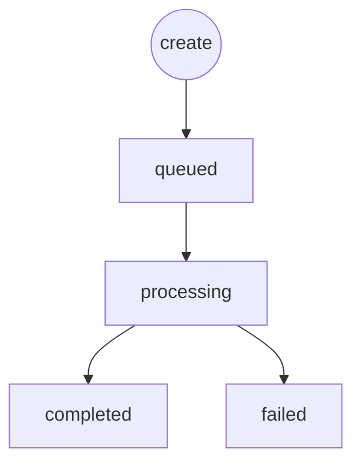

> Video URLs (`result.video_url`) are kept for about **3 days**. Download promptly.

Create and query share the same `data` shape. `data.cost` is the charged amount (credits).

### Status values

| status | Meaning | progress |
| :--- | :--- | :--- |
| `queued` / `pending` / `submitted` | Submitted, waiting | `0` |
| `processing` / `in_progress` / `running` | Generating | `1–99` |
| `completed` / `success` / `succeeded` | Done — read `result.video_url` | `100` |
| `failed` | Failed — see `error_message` | `0` |



```bash
curl -X GET 'https://sigrunai.com/v1/videos/vid_xxxxxxxx' \
  -H 'Authorization: Bearer sk_xxx'
```
