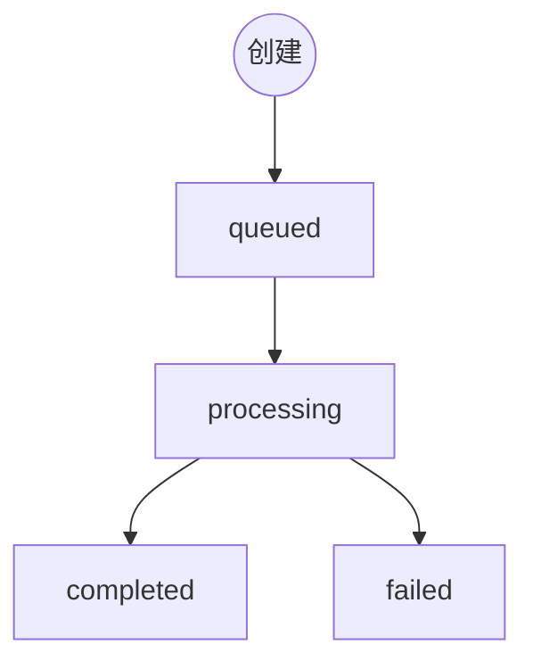

> 视频地址（`result.video_url`）保存有效期约 **3 天**，请及时转存。

创建与查询返回同一套 `data` 结构；`data.cost` 为本次扣费（积分）。

### 任务状态

| status | 说明 | progress |
| :--- | :--- | :--- |
| `queued` / `pending` / `submitted` | 已提交，等待调度 | `0` |
| `processing` / `in_progress` / `running` | 生成中 | `1–99` |
| `completed` / `success` / `succeeded` | 成功，可读 `result.video_url` | `100` |
| `failed` | 失败，见 `error_message` | `0` |



```bash
curl -X GET 'https://sigrunai.com/v1/videos/vid_xxxxxxxx' \
  -H 'Authorization: Bearer sk_xxx'
```
